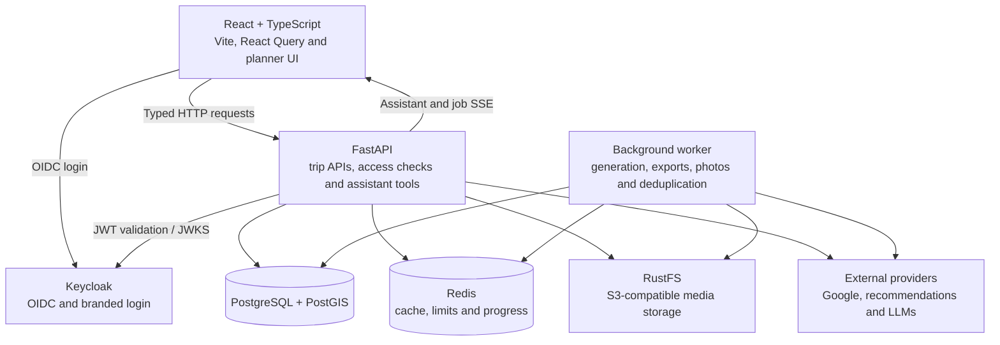

<div align="center">


# Voyager

An AI-assisted travel planning workspace: discover places, organise each day, refine the itinerary with an
assistant, and keep maps, collaborators, media and exports connected to the same trip.

[Overview](#overview) · [What it shows](#what-this-project-shows) · [Workflow](#the-workflow) · [Engineering decisions](#engineering-decisions) · [Architecture](#architecture) · [Run it](#run-it)

</div>

## Overview

Trip planning brought together several kinds of information: places worth visiting, opening hours, travel times,
dates, budgets and the preferences of the people travelling. Voyager combined those concerns in a full-stack
application, with a day-by-day planner, an interactive map and an assistant connected to the trip's actual data.

The workspace supported creating a trip, collecting ideas in an inbox, scheduling and moving activities, reviewing
place details and routes, sharing access, and exporting the result. The assistant could search for places, edit
activities and request itinerary generation. For assistant actions, deleting an activity, resetting a plan or
replacing an itinerary required confirmation in the application before execution.

## What this project shows

- **An assistant connected to application state.** Persisted conversations, trip-context tools, place search and
  activity actions connected the chat interface to the planner. Backend confirmation gates covered destructive
  actions, and `/generate` and `/reset` commands exposed the longer-running workflows.
- **Interactive itinerary planning.** Drag-and-drop scheduling, an activity inbox, visited states, budgets,
  place-detail sheets, photos, reviews, opening hours and travel estimates kept the plan editable by the user.
- **External data and model integration.** Google Maps and Places supplied location data; a TripAdvisor-compatible
  provider supplied recommendations. Configurable OpenRouter, Mistral and Gemini integrations handled the assistant
  and generation requests, with model ordering, timeouts and bounded rate-limit retries.
- **Background work with visible progress.** Itinerary generation, exports, photo refresh and deduplication ran in a
  separate worker. Jobs persisted their status and retry attempts, while Server-Sent Events exposed progress to
  the frontend.
- **Shared trips and controlled writes.** Invitations and access checks supported collaboration. Trip versions,
  `If-Match` headers and idempotency keys protected selected mutation and job-submission paths.
- **A complete local stack.** Docker Compose brought together the React frontend, FastAPI backend, worker,
  PostgreSQL/PostGIS, Redis, Keycloak, S3-compatible storage and a local email catcher.

## The workflow

The planner kept manual editing, recommendations and assistant actions around the same trip. Long-running work
returned a job, allowing the interface to show progress while the worker processed it.


The main UI covered trip workspaces, planning, maps, recommendations, assistant conversations, sharing, media and
exports. Additional backend services handled geospatial layers, place deduplication, optimisation proposals and
audit records.

## Engineering decisions

| Decision | Why |
| --- | --- |
| The assistant called a fixed set of backend tools | Search and planner changes used explicit application operations and existing access checks |
| Destructive assistant actions paused for confirmation | Deleting, resetting or replacing a plan required a separate user decision before execution |
| FastAPI exposed typed contracts; the frontend used generated OpenAPI types | `openapi-fetch` kept frontend requests aligned with the API schema |
| Long-running work ran in a separate worker | Generation, exports and maintenance jobs had persisted status, retry handling and progress outside the HTTP request |
| PostgreSQL/PostGIS stored the core data; Redis handled transient state | Trips and jobs stayed in relational storage, while caching, rate limits, idempotency records and progress used Redis |
| Selected writes used trip versions and idempotency keys | Concurrent edits could be checked, and repeated submissions could reuse an existing result |
| Keycloak handled OIDC; FastAPI validated JWTs through JWKS | Identity and login flows stayed separate from trip-planning logic |
| Media lived in S3-compatible object storage | Uploads, photos and generated assets were separated from relational records |
| Browser state was split between React Query and Zustand | Remote data and cache invalidation stayed separate from local interface state |

Implementation: [assistant orchestration](api/app/services/planner_assistant.py),
[tool definitions and execution](api/app/services/planner_assistant_tools.py),
[job worker](api/app/worker/main.py) and [trip API](api/app/routers/trips.py).

## Architecture



The API handled requests and assistant interactions. PostgreSQL stored trips, days, activities, conversations and
jobs; the worker picked up pending jobs and published progress through Redis. The frontend consumed API data with
React Query and received assistant and job events over SSE.

**Stack:** Python 3.12+, FastAPI, SQLAlchemy, Alembic · PostgreSQL 16, PostGIS, Redis 7 · React 18,
TypeScript, Vite, React Router, TanStack Query, Zustand, Tailwind CSS v4 and Radix UI · Google Maps, deck.gl,
Terra Draw and dnd-kit · Keycloak, RustFS, Mailpit · Docker Compose.

## Run it

From the repository root, create the local environment file and start the Docker stack:

```bash
cp .env.example .env
docker compose up -d --build
```

`make up` ran the same startup command. The API applied database migrations on startup.

| Service | Local address |
| --- | --- |
| Voyager | [localhost:5173](http://localhost:5173) |
| API documentation | [localhost:8000/docs](http://localhost:8000/docs) |
| Keycloak | [localhost:8080](http://localhost:8080) |
| Mailpit | [localhost:8025](http://localhost:8025) |
| RustFS API | [localhost:9000](http://localhost:9000) |
| RustFS console | [localhost:9001](http://localhost:9001) |

The imported local realm included these demo accounts. The password was `voyager_pass` for all three:

| Username | Realm roles |
| --- | --- |
| `voyager_user` | User |
| `voyager_user_2` | User |
| `voyager_admin` | User, admin |

### External integrations

The local services and third-party integrations were configured separately in [`.env.example`](.env.example):

| Integration | Configuration |
| --- | --- |
| Google Maps in the browser | `VITE_GOOGLE_MAPS_API_KEY`; optional `VITE_GOOGLE_MAPS_MAP_ID` |
| Backend Google place and route requests | `VOYAGER_GOOGLE_MAPS_API_KEY` |
| Assistant and AI itinerary generation | `VOYAGER_LLM_OPENROUTER_API_KEY`, `VOYAGER_LLM_MISTRAL_API_KEY` or `VOYAGER_LLM_GEMINI_API_KEY`; provider model orders and timeouts were configurable |
| Activity recommendations | `VOYAGER_ACTIVITIES_TRIPADVISOR_BASE_URL` |
| Optional Google login through Keycloak | `KEYCLOAK_GOOGLE_CLIENT_ID` and `KEYCLOAK_GOOGLE_CLIENT_SECRET` |

Google-backed maps and place data needed the corresponding Google configuration. Assistant model calls needed a
configured provider key. Provider URLs, credentials and settings belonged in the local environment file.

### Development checks

The repository exposed backend linting and frontend lint/build commands:

```bash
make lint                       # host Python environment managed by uv
cd frontend
bun install --frozen-lockfile
bun run lint
bun run build
```

Logs were available through `make logs`, `make logs-worker` and `make logs-frontend`.

## Repository layout

| Path | Contents |
| --- | --- |
| [`frontend/src/pages/`](frontend/src/pages/) | Landing, sign-in, trips, planner, invites and settings screens |
| [`frontend/src/widgets/`](frontend/src/widgets/) | Planner board, map, assistant, activity details and media widgets |
| [`frontend/src/entities/`](frontend/src/entities/) | Typed domain API clients, queries and cache helpers |
| [`api/app/routers/`](api/app/routers/) | Trip, activity, assistant, sharing, media, job and export endpoints |
| [`api/app/services/`](api/app/services/) | LLM integrations, assistant tools, discovery, routing and export pipelines |
| [`api/app/worker/`](api/app/worker/) | Background job processing and retry handling |
| [`api/app/db/`](api/app/db/) | Models, repositories, sessions and audit context |
| [`api/app/migrations/`](api/app/migrations/) | Alembic database migrations |
| [`infra/`](infra/) | Keycloak realm, authentication theme build and infrastructure configuration |
| [`docker-compose.yml`](docker-compose.yml) | The nine-service local stack |

## Author

[Daniil Hirchyts](https://github.com/Daniil-Hirchyts).
